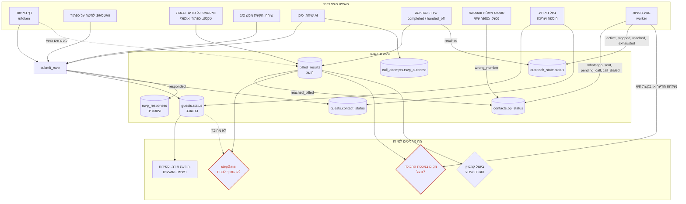

# מפת כתיבת הסטטוסים של אורח — KALFA beta

מצב נכון ל־2.11.2026. הקוד: `main` בקומיט `dd87aa66`. המסד: החי, 408 מתוך 408 מיגרציות מסונכרנות.

**איך נאסף:**
1. מסד חי: כל עמודה שנראית כסטטוס בכל טבלה שמקושרת ל־`guests` או `contacts`; כל הפונקציות בכל ה־schemas (כולל SQL דינמי), טריגרים ו־cron.
2. Serena: כל `insert`/`update`/`upsert`/`delete` על עשר הטבלאות בכל הפרויקט (51 מקומות), כל אחד ממופה לפונקציה המכילה ולעמודות שהוא כותב.
3. Serena: מי קורא לכל פונקציה כותבת, ומסלול הקריאה עד נקודת הכניסה (דף, route או ה־worker).
4. ערכים במסד החי לעמודות שאין להן כותב.

## 1. מלאי הסטטוסים

| עמודה | סוג וערכים | ברירת מחדל | מי כותב |
|---|---|---|---|
| `guests.status` | enum `guest_status`: pending, attending, declined, maybe | `pending` | `submit_rsvp`, `createGuest`, `updateGuest` |
| `guests.contact_status` | enum `contact_status`: not_contacted, contacted, responded, wrong_number, unclear, unavailable, callback | `not_contacted` | `submit_rsvp` (`responded` בלבד), `createGuest`, `updateGuest`, `updateContactStatus` |
| `contacts.op_status` | enum `contact_op_status`: pending_contact, whatsapp_sent, pending_call, call_dialed, no_answer, human_interaction_call, wrong_number, reached_billed | `pending_contact` | `setContactOpStatus` (7 מקומות) |
| `outreach_state.status` | text, בלי constraint. ערכים בקוד: active, reached, stopped, exhausted | `active` | `seedOutreachState` (יצירה), `setOutreachStatus`, `resolve_outreach_step` |
| `outreach_state.stop_reason` | text, בלי constraint | ריק | `setOutreachStatus`, `resolve_outreach_step` (כש־`advance=false`, לערך של `p_reason`) |
| `outreach_state.reached_at` | timestamptz | ריק | `setOutreachStatus` (רק ב־`reached`) |
| שורה ב־`billed_results` ("הושג") | — | — | `try_record_billed_result` ← `recordReached` |
| שורה ב־`rsvp_responses` (היסטוריה) | — | — | `submit_rsvp` בלבד |
| `call_attempts.rsvp_outcome` | text + check | ריק | `setCallAttemptRsvpOutcome` |
| `call_dispatch_status.status` | text + check | — | `recordDispatchAccepted`, `settleDispatch`. במסד החי: 0 שורות |

**ערכים מותרים לפי ה־constraints במסד החי:**

- `call_attempts.call_attempts_rsvp_outcome_check`: `CHECK (((rsvp_outcome IS NULL) OR (rsvp_outcome = ANY (ARRAY['attending'::text, 'declined'::text, 'maybe'::text]))))`
- `call_dispatch_status.call_dispatch_status_reason_check`: `CHECK (((reason IS NULL) OR (reason = ANY (ARRAY['already_reached'::text, 'outside_dial_window'::text, 'campaign_not_active'::text, 'event_closed'::text, 'concurrent_owner'::text, 'max_concurrency'::text, 'campaign_hour_cap'::text, 'outreach_disabled'::text, 'config_missing'::text, 'live_calls_disabled'::text, 'balance_below_reserve'::text, 'already_dispatched'::text, 'already_concluded'::text, 'failed_to_start'::text, 'start_unknown'::text, 'temporary_dispatch_failure'::text, 'waiting_for_quota'::text]))))`
- `call_dispatch_status.call_dispatch_status_status_check`: `CHECK ((status = ANY (ARRAY['accepted'::text, 'dispatched'::text, 'skipped'::text, 'blocked'::text, 'failed'::text, 'unknown'::text])))`
- `console_calls.console_calls_status_check`: `CHECK ((status = ANY (ARRAY['initiated'::text, 'ringing'::text, 'connected'::text, 'ended'::text, 'missed'::text, 'failed'::text, 'no_agent'::text])))`
- `inbound_agent_attempts.inbound_agent_attempts_status_valid`: `CHECK ((status = ANY (ARRAY['issued'::text, 'bridged'::text, 'completed'::text, 'no_response'::text, 'failed'::text])))`

## 2. הכותבים בקוד: מה, מאיפה, והקוד

### `submitRsvp` — `src/lib/data/rsvp.ts:162-195`

קורא ל־RPC `submit_rsvp`, שכותב `guests.status`, `guests.contact_status='responded'` ושורה ב־`rsvp_responses`.

**נקודות כניסה:** `src/app/(public)/r/[token]/page.tsx :: RsvpPage`; `src/app/api/voximplant/agent-tool/rsvp/[token]/route.ts :: POST`; `worker/main.ts :: main`

**נקרא מ־:**

- `src/app/(public)/r/[token]/actions.ts:94` (submitRsvpAction/stateAction() callback/outcome): `const outcome = await submitRsvp(token, parsed.data); `
- `src/lib/data/call-result-processing.ts:146` (processCallResult/outcome): `const outcome = await submitRsvp(rsvpToken, { status,`
- `src/lib/data/call-result-processing.ts:257` (processCallRsvp/outcome): `const outcome = await submitRsvp(rsvpToken, { status,`
- `src/lib/data/webhook-processing.ts:490` (processMessage/outcome[1]): `const outcome = await submitRsvp(guest.rsvp_token, { status: rsvpStatus,`

```ts
export async function submitRsvp(
  token: string,
  input: RsvpSubmitInput,
): Promise<RsvpSubmitOutcome> {
  const supabase = createAdminClient();
  const { data, error } = await supabase.rpc('submit_rsvp', {
    _token: token,
    _status: input.status,
    _adults: input.adults,
    _kids: input.kids,
    _meal: input.meal_pref ?? '',
    _note: input.note ?? '',
    _answers: (input.answers ?? {}) as Json,
    _show_in_list: input.show_in_guest_list ?? false,
  });
  if (error) {
    throw new Error('שליחת אישור ההגעה נכשלה', { cause: error });
  }

  const result = (data ?? {}) as {
    ok?: boolean;
    reason?: string;
    status?: string;
    unchanged?: boolean;
  };

  if (result.ok) {
    const unchanged = result.unchanged === true;
    // Fire-and-forget audit; a failure here must never fail a successful RSVP.
    void recordRsvpAudit(supabase, token, input.status, unchanged);
    return { ok: true, status: input.status, unchanged };
  }
  return { ok: false, reason: (result.reason ?? 'not_found') as RsvpFailureReason };
}
```

### `createGuest` — `src/lib/data/guests.ts:442-493`

יוצר אורח עם `status` ו־`contact_status` מהטופס (בעל האירוע).

**נקודות כניסה:** `src/app/(customer)/app/events/[id]/guests/[guestId]/page.tsx :: EditGuestPage`; `src/app/(customer)/app/events/[id]/guests/new/page.tsx :: NewGuestPage`

**נקרא מ־:**

- `src/app/(customer)/app/events/[id]/guests/guests-actions.ts:56` (createGuestAction/stateAction() callback/created): `const created = await createGuest(eventId, { full_name: d.full_name,`

```ts
export async function createGuest(
  eventId: string,
  input: GuestWriteInput,
): Promise<GuestListItem> {
  await requireEventAccess(eventId, 'guests', 'create');
  const supabase = await createClient();

  const { data, error } = await supabase
    .from('guests')
    .insert({
      event_id: eventId,
      full_name: input.full_name,
      phone: input.phone ?? null,
      status: input.status,
      contact_status: input.contact_status,
      group_id: input.group_id ?? null,
      expected_count: input.expected_count ?? null,
      note: input.note ?? null,
    })
    .select(GUEST_LIST_COLUMNS)
    .single();

  if (error || !data) {
    throwFriendlyGuestError(error, 'יצירת המוזמן נכשלה');
  }
  // Same boundary cast as listGuests (over_invited computed field).
  const row = data as unknown as GuestListQueryRow;

  await logActivity({
    eventId,
    action: 'guest.created',
    meta: {
      guestId: data.id,
      groupId: data.group_id,
      status: data.status,
      contactStatus: data.contact_status,
      fields: Object.keys(input),
    },
  });

  // Flatten the embedded contact into the same DTO shape listGuests returns. A
  // freshly-created guest has no contact link or outbound send yet, so the
  // webhook-driven fields are null; the mapping stays robust if a contact embed
  // is ever present.
  const { contacts, over_invited, ...rest } = row;
  return {
    ...rest,
    over_invited: over_invited === true,
    op_status: contacts?.op_status ?? null,
    delivery_status: null,
  };
}
```

### `updateGuest` — `src/lib/data/guests.ts:549-598`

עריכת אורח: מעדכן `status` ו־`contact_status` כשהם נשלחו (בעל האירוע).

**נקודות כניסה:** `src/app/(customer)/app/events/[id]/guests/[guestId]/page.tsx :: EditGuestPage`; `src/app/(customer)/app/events/[id]/guests/new/page.tsx :: NewGuestPage`

**נקרא מ־:**

- `src/app/(customer)/app/events/[id]/guests/guests-actions.ts:126` (updateGuestAction/stateAction() callback): `await updateGuest(eventId, guestId, { full_name: d.full_name,`

```ts
export async function updateGuest(
  eventId: string,
  guestId: string,
  patch: Partial<GuestWriteInput>,
): Promise<GuestDetail> {
  await requireEventAccess(eventId, 'guests', 'edit');
  const supabase = await createClient();
  const previous = await getGuest(eventId, guestId);

  // Build the update payload from the allow-listed fields only.
  const update: TablesUpdate<'guests'> = {};
  if (patch.full_name !== undefined) update.full_name = patch.full_name;
  if (patch.phone !== undefined) update.phone = patch.phone;
  if (patch.status !== undefined) update.status = patch.status;
  if (patch.contact_status !== undefined)
    update.contact_status = patch.contact_status;
  if (patch.group_id !== undefined) update.group_id = patch.group_id;
  if (patch.expected_count !== undefined)
    update.expected_count = patch.expected_count;
  if (patch.note !== undefined) update.note = patch.note;

  const { data, error } = await supabase
    .from('guests')
    .update(update)
    .eq('event_id', eventId)
    .eq('id', guestId)
    .select(GUEST_DETAIL_COLUMNS)
    .single();

  if (error || !data) {
    throwFriendlyGuestError(error, 'עדכון המוזמן נכשל');
  }

  await logActivity({
    eventId,
    action: 'guest.updated',
    meta: {
      guestId,
      previousStatus: previous?.status ?? null,
      status: data.status,
      previousContactStatus: previous?.contact_status ?? null,
      contactStatus: data.contact_status,
      previousGroupId: previous?.group_id ?? null,
      groupId: data.group_id,
      fields: Object.keys(patch),
    },
  });

  return data;
}
```

### `updateContactStatus` — `src/lib/data/guests.ts:653-681`

מעדכן `guests.contact_status` בלבד (בעל האירוע).

**נקודות כניסה:** `src/app/(customer)/app/events/[id]/guests/page.tsx :: GuestsPage`

**נקרא מ־:**

- `src/app/(customer)/app/events/[id]/guests/guests-actions.ts:180` (setContactStatusAction/action() callback): `await updateContactStatus(eventId, guestId, value); } catch (err) {`

```ts
export async function updateContactStatus(
  eventId: string,
  guestId: string,
  contactStatus: ContactStatus,
): Promise<void> {
  await requireEventAccess(eventId, 'guests', 'edit');
  const supabase = await createClient();
  const previous = await getGuest(eventId, guestId);

  const { error } = await supabase
    .from('guests')
    .update({ contact_status: contactStatus })
    .eq('event_id', eventId)
    .eq('id', guestId);

  if (error) {
    throw new Error('עדכון סטטוס יצירת הקשר נכשל', { cause: error });
  }

  await logActivity({
    eventId,
    action: 'guest.contact_status_updated',
    meta: {
      guestId,
      previousContactStatus: previous?.contact_status ?? null,
      contactStatus,
    },
  });
}
```

### `setContactOpStatus` — `src/lib/data/interactions.ts:157-167`

הכותב היחיד של `contacts.op_status`.

**נקודות כניסה:** `scripts/voximplant/outreach-call.ts :: main`; `worker/main.ts :: main`

**נקרא מ־:**

- `src/lib/data/billing.ts:47` (recordReached): `await setContactOpStatus(args.contactId, 'reached_billed'); }`
- `src/lib/data/call-result-processing.ts:64` (processCallResult): `if (applied) await setContactOpStatus(attempt.contact_id, 'human_interaction_call'); return;`
- `src/lib/data/call-result-processing.ts:188` (processCallResult): `if (applied && op) await setContactOpStatus(attempt.contact_id, op); }`
- `src/lib/data/outreach-calls.ts:144` (finishDialed): `await setContactOpStatus(job.contactId, 'call_dialed'); }`
- `src/lib/data/outreach-engine.ts:495` (prepareAndSendStep): `await setContactOpStatus(contactId, 'whatsapp_sent'); }`
- `src/lib/data/outreach-engine.ts:517` (prepareAndSendStep): `await setContactOpStatus(contactId, 'pending_call'); return { kind: 'advance', reason: 'call_requested' };`
- `src/lib/data/webhook-processing.ts:549` (processStatus): `await setContactOpStatus(contactId, 'wrong_number'); }`

```ts
export async function setContactOpStatus(
  contactId: string,
  status: OpStatus,
): Promise<void> {
  const admin = createAdminClient();
  const { error } = await admin
    .from('contacts')
    .update({ op_status: status })
    .eq('id', contactId);
  if (error) throw new Error('עדכון סטטוס איש הקשר נכשל', { cause: error });
}
```

### `seedOutreachState` — `src/lib/data/outreach-engine.ts:75-100`

יוצר שורות `outreach_state`. לא כותב `status`, ולכן חל ערך ברירת המחדל `active`.

**נקודות כניסה:** `worker/main.ts :: main`

**נקרא מ־:**

- `worker/main.ts:610` (handleArm): `await seedOutreachState(camp.event_id, camp.id); for (const row of await listActiveOutreach(camp.id)) {`

```ts
export async function seedOutreachState(
  eventId: string,
  campaignId: string,
): Promise<number> {
  const admin = createAdminClient();
  const { data: set, error } = await admin
    .from('campaign_authorized_contacts')
    .select('contact_id')
    .eq('campaign_id', campaignId);
  if (error) throw new Error('טעינת מערך אנשי הקשר נכשלה', { cause: error });
  const rows = (set ?? []).map((r) => ({
    event_id: eventId,
    campaign_id: campaignId,
    contact_id: r.contact_id,
  }));
  if (rows.length > 0) {
    const { error: insErr } = await admin
      .from('outreach_state')
      .upsert(rows, {
        onConflict: 'campaign_id,contact_id',
        ignoreDuplicates: true,
      });
    if (insErr) throw new Error('יצירת מצב ה-outreach נכשלה', { cause: insErr });
  }
  return rows.length;
}
```

### `setOutreachStatus` — `src/lib/data/outreach-engine.ts:248-266`

כותב `outreach_state.status`, ולפי הצורך `stop_reason` ו־`reached_at`.

**נקודות כניסה:** `worker/main.ts :: main`

**נקרא מ־:**

- `src/lib/data/outreach-engine.ts:304` (writeReach): `await setOutreachStatus(args.campaignId, args.contactId, 'reached', 'reached'); }`
- `src/lib/data/outreach-engine.ts:544` (ensureCurrentStep): `await setOutreachStatus(campaignId, contactId, 'exhausted'); return;`
- `worker/main.ts:417` (handleStep): `await setOutreachStatus(campaignId, contactId, 'stopped', 'closed'); return;`
- `worker/main.ts:421` (handleStep): `await setOutreachStatus(campaignId, contactId, 'reached', 'reached'); return;`
- `worker/main.ts:437` (handleStep): `await setOutreachStatus(campaignId, contactId, 'stopped', 'closed'); return;`
- `worker/main.ts:441` (handleStep): `await setOutreachStatus(campaignId, contactId, 'reached', 'reached'); return;`
- `worker/main.ts:454` (handleStep): `await setOutreachStatus(campaignId, contactId, 'exhausted'); return;`

```ts
export async function setOutreachStatus(
  campaignId: string,
  contactId: string,
  status: 'reached' | 'stopped' | 'exhausted',
  stopReason?: string,
): Promise<void> {
  const admin = createAdminClient();
  const patch: { status: string; stop_reason?: string; reached_at?: string } = {
    status,
  };
  if (stopReason) patch.stop_reason = stopReason;
  if (status === 'reached') patch.reached_at = new Date().toISOString();
  const { error } = await admin
    .from('outreach_state')
    .update(patch)
    .eq('campaign_id', campaignId)
    .eq('contact_id', contactId);
  if (error) throw new Error('עדכון סטטוס ה-outreach נכשל', { cause: error });
}
```

### `resolveStep` — `src/lib/data/outreach-engine.ts:364-393`

קורא ל־RPC `resolve_outreach_step`. משנה `status` ו־`stop_reason` רק כש־`advance=false`: `status` לערך של `terminalStatus`, ו־`stop_reason` לערך של `reason`.

בקוד, רק `outreach-engine.ts:587` מעביר `advance: false`, עם `terminalStatus: 'exhausted'`. כל שאר הקריאות (`outreach-engine.ts:602`, `worker/main.ts:550`, וכל הקריאות ב־`src/lib/outreach/enqueue.ts` דרך `worker/main.ts:399`) מעבירות `advance: true, terminalStatus: null`, ולכן לא משנות סטטוס.

**נקודות כניסה:** `worker/main.ts :: main`

**נקרא מ־:**

- `src/lib/data/outreach-engine.ts:587` (ensureCurrentStep): `await resolveStep({ campaignId,`
- `src/lib/data/outreach-engine.ts:602` (ensureCurrentStep/res): `const res = await resolveStep({ campaignId,`
- `worker/main.ts:399` (buildExecutionDeps): `resolve: (a) => resolveStep(a), auditId: (reason) => stepAuditId(campaignId, contactId, stepIndex, planRev, reason),`
- `worker/main.ts:550` (handleDead): `await resolveStep({ campaignId,`

```ts
export async function resolveStep(input: {
  campaignId: string;
  contactId: string;
  stepIndex: number;
  planRev: string;
  // null = a NON-reserved skip/terminal (superseded/missed/expired/internal_fault);
  // non-null = a send-path resolve guarded to the reserving job.
  jobId: string | null;
  advance: boolean;
  terminalStatus: string | null;
  reason: string;
  eventId: string;
  auditId: string;
}): Promise<'resolved' | 'stale' | 'error'> {
  const admin = createAdminClient();
  const { data, error } = await admin.rpc('resolve_outreach_step', {
    p_campaign: input.campaignId,
    p_contact: input.contactId,
    p_step: input.stepIndex,
    p_expected_plan_rev: input.planRev,
    p_job_id: input.jobId,
    p_advance: input.advance,
    p_terminal_status: input.terminalStatus,
    p_reason: input.reason,
    p_event_id: input.eventId,
    p_audit_id: input.auditId,
  });
  if (error) return 'error';
  return (data as 'resolved' | 'stale') ?? 'error';
}
```

### `writeReach` — `src/lib/data/outreach-engine.ts:297-307`

רישום "הושג": `recordReached`, ואחריו `setOutreachStatus(..., 'reached', 'reached')`.

**נקודות כניסה:** `worker/main.ts :: main`

**נקרא מ־:**

- `src/lib/data/call-result-processing.ts:112` (processCallResult): `await writeReach({ eventId: attempt.event_id,`

```ts
export async function writeReach(args: ReachedArgs): Promise<string> {
  const outcome = await recordReached(args);
  // 'already_billed' also means reached: a contact that was billed is reached, and
  // a replay after a crash between the billing RPC and this status write must
  // complete the marker that was lost. Idempotent — re-running only refreshes
  // reached_at.
  if (outcome === 'billed' || outcome === 'already_billed') {
    await setOutreachStatus(args.campaignId, args.contactId, 'reached', 'reached');
  }
  return outcome;
}
```

### `recordReached` — `src/lib/data/billing.ts:33-50`

קורא ל־RPC `try_record_billed_result` (שורה ב־`billed_results`) ואחר כך `setContactOpStatus('reached_billed')`.

**נקודות כניסה:** `worker/main.ts :: main`

**נקרא מ־:**

- `src/lib/data/outreach-engine.ts:298` (writeReach/outcome): `const outcome = await recordReached(args); // 'already_billed' also means reached: a contact that was billed is reached, and`
- `src/lib/data/webhook-processing.ts:442` (processMessage/outcome[0]): `const outcome = await recordReached({ eventId: resolved.eventId,`

```ts
export async function recordReached(args: ReachedArgs): Promise<string> {
  const admin = createAdminClient();
  const { data, error } = await admin.rpc('try_record_billed_result', {
    p_event: args.eventId,
    p_campaign: args.campaignId,
    p_contact: args.contactId,
    p_channel: args.channel,
    p_attempt: args.attemptId,
    p_evidence: args.evidence,
    p_provider_ref: args.providerRef,
  });
  if (error) throw new Error('רישום החיוב נכשל', { cause: error });
  const outcome = typeof data === 'string' ? data : 'unknown';
  if (outcome === 'billed') {
    await setContactOpStatus(args.contactId, 'reached_billed');
  }
  return outcome;
}
```

### `setCallAttemptRsvpOutcome` — `src/lib/data/call-attempts.ts:317-327`

כותב `call_attempts.rsvp_outcome` (תצוגה בלבד).

**נקודות כניסה:** `src/app/api/voximplant/agent-tool/rsvp/[token]/route.ts :: POST`; `worker/main.ts :: main`

**נקרא מ־:**

- `src/lib/data/call-result-processing.ts:237` (processCallRsvp): `await setCallAttemptRsvpOutcome(attemptId, voxSaveRsvpStatus(body)); } catch {`

```ts
export async function setCallAttemptRsvpOutcome(
  attemptId: string,
  outcome: 'attending' | 'declined' | 'maybe',
): Promise<void> {
  const admin = createAdminClient();
  const { error } = await admin
    .from('call_attempts')
    .update({ rsvp_outcome: outcome })
    .eq('id', attemptId);
  if (error) throw new Error('עדכון תוצאת ה-RSVP על ניסיון השיחה נכשל', { cause: error });
}
```

### `recordDispatchAccepted` — `src/lib/data/call-dispatch-status.ts:146-174`

יוצר שורה ב־`call_dispatch_status`.

**נקודות כניסה:** `src/app/api/events/[eventId]/outreach-call/route.ts :: POST`

**נקרא מ־:**

- `src/app/api/events/[eventId]/outreach-call/route.ts:165` (POST): `if (!(await recordDispatchAccepted({ dispatchId, eventId, contactId: guest.contact_id }))) { return json({ error: 'רישום הבקשה נכשל' }, 500);`

```ts
export async function recordDispatchAccepted(args: {
  dispatchId: string;
  eventId: string;
  contactId: string;
}): Promise<boolean> {
  try {
    const admin = createAdminClient();
    const row: DispatchInsert = {
      dispatch_id: args.dispatchId,
      event_id: args.eventId,
      contact_id: args.contactId,
      status: 'accepted',
    };
    const { error } = await admin.from('call_dispatch_status').insert(row);
    if (error) {
      console.error('[call-dispatch-status] accepted insert failed', {
        dispatchId: args.dispatchId,
        code: error.code,
      });
    }
    return !error;
  } catch (e) {
    console.error('[call-dispatch-status] accepted insert threw', {
      dispatchId: args.dispatchId,
      detail: e instanceof Error ? e.message : 'unknown error',
    });
    return false;
  }
}
```

### `settleDispatch` — `src/lib/data/call-dispatch-status.ts:193-220`

מעדכן `call_dispatch_status.status`.

**נקודות כניסה:** `src/app/api/events/[eventId]/outreach-call/route.ts :: POST`; `worker/main.ts :: main`

**נקרא מ־:**

- `src/lib/data/call-dispatch-status.ts:235` (settleDispatchFailure): `await settleDispatch({ dispatchId: args.dispatchId,`
- `src/lib/data/call-dispatch-status.ts:257` (settleManualDispatch): `await settleDispatch({ dispatchId: job.dispatchId,`

```ts
export async function settleDispatch(args: {
  dispatchId: string;
  eventId: string;
  contactId: string;
  settlement: DispatchSettlement;
}): Promise<void> {
  const admin = createAdminClient();
  const row: DispatchInsert = {
    dispatch_id: args.dispatchId,
    event_id: args.eventId,
    contact_id: args.contactId,
    status: args.settlement.status,
    reason: args.settlement.reason,
    call_attempt_id: args.settlement.attemptId,
    updated_at: new Date().toISOString(),
  };
  const { error } = await admin
    .from('call_dispatch_status')
    .upsert(row, { onConflict: 'dispatch_id' });
  if (error) {
    console.error('[call-dispatch-status] settle failed', {
      dispatchId: args.dispatchId,
      status: args.settlement.status,
      code: error.code,
    });
    throw new Error(`call_dispatch_status settle failed: ${error.code ?? 'unknown'}`);
  }
}
```

### `runDispatchRetention` — `src/lib/data/call-dispatch-status.ts:273-288`

מוחק שורות ישנות מ־`call_dispatch_status`.

**נקודות כניסה:** `worker/main.ts :: main`

**נקרא מ־:**

- `worker/main.ts:1305` (main/guardedWorker() callback[29]): `await runDispatchRetention(); }),`

```ts
export async function runDispatchRetention(): Promise<void> {
  try {
    const cutoff = new Date(Date.now() - RETENTION_DAYS * 24 * 60 * 60 * 1000).toISOString();
    const admin = createAdminClient();
    const { error } = await admin.from('call_dispatch_status').delete().lt('created_at', cutoff);
    if (error) {
      console.error('[call-dispatch-status] retention sweep failed', { code: error.code });
    }
  } catch (e) {
    // Never throws — a failed sweep just runs again tomorrow. Logged, not
    // silent: unbounded growth is the failure mode this cron exists to stop.
    console.error('[call-dispatch-status] retention sweep threw', {
      detail: e instanceof Error ? e.message : 'unknown error',
    });
  }
}
```

## 3. פונקציות במסד שכותבות סטטוס (ההגדרה החיה)

`record_step_plan`, `reserve_outreach_step` ו־`release_outreach_reservation` מעדכנות את `outreach_state` אבל לא את `status` (נבדק: הן קובעות רק `plan_rev`, `planned_at`, `planned_step_index`, `dispatched_at`, `dispatched_job_id`). ל־`release_outreach_reservation` אין קורא.

### `submit_rsvp`

```sql
CREATE OR REPLACE FUNCTION public.submit_rsvp(_token text, _status text, _adults integer, _kids integer, _meal text, _note text, _answers jsonb DEFAULT '{}'::jsonb, _show_in_list boolean DEFAULT false)
 RETURNS jsonb
 LANGUAGE plpgsql
 SECURITY DEFINER
 SET search_path TO 'public'
AS $function$
declare
  _g          public.guests;
  _e          public.events;
  _answers_in jsonb   := coalesce(_answers, '{}'::jsonb);
  _adults_n   integer := greatest(coalesce(_adults, 0), 0);
  _kids_n     integer := greatest(coalesce(_kids, 0), 0);
  _attending  boolean;
  _total      integer;
  _meal_n     text;
  _note_n     text;
  _show_list_n boolean;
  _q          record;
  _val        text;
  _last       public.rsvp_responses;
begin
  -- (a) status whitelist.
  if _status is null or _status not in ('attending', 'declined', 'maybe') then
    return jsonb_build_object('ok', false, 'reason', 'invalid_status');
  end if;

  -- (b) resolve + LOCK the guest by token; revoked or unknown token are both
  --     'not_found' (no enumeration signal). The lock makes the idempotency
  --     check below race-safe under concurrent submits.
  select * into _g
    from public.guests
   where rsvp_token = _token
     and rsvp_token_revoked_at is null
   for update;
  if not found then
    return jsonb_build_object('ok', false, 'reason', 'not_found');
  end if;

  -- (c) event gates: active + NOT a past event day + deadline (Asia/Jerusalem).
  select * into _e from public.events where id = _g.event_id;
  if not found or _e.status <> 'active' then
    return jsonb_build_object('ok', false, 'reason', 'closed');
  end if;
  -- L2: a past event (calendar day in Israel) is closed for RSVP, regardless of
  -- the deadline. NULL event_date does not gate.
  if _e.event_date is not null
     and (now() at time zone 'Asia/Jerusalem')::date
           > (_e.event_date at time zone 'Asia/Jerusalem')::date then
    return jsonb_build_object('ok', false, 'reason', 'closed');
  end if;
  if _e.rsvp_deadline is not null
     and (now() at time zone 'Asia/Jerusalem')::date > _e.rsvp_deadline then
    return jsonb_build_object('ok', false, 'reason', 'deadline_passed');
  end if;

  -- (d) normalize per status. attending: 1 <= adults+kids <= expected_count
  --     (no upper cap when expected_count IS NULL). declined/maybe: counts 0 and
  --     meal cleared (a meal preference is only meaningful when attending).
  _attending := case _status when 'attending' then true
                             when 'declined'  then false
                             else null end;  -- 'maybe'

  if _status = 'attending' then
    _total := _adults_n + _kids_n;
    if _total < 1 then
      return jsonb_build_object('ok', false, 'reason', 'invalid_count');
    end if;
    if _g.expected_count is not null and _total > _g.expected_count then
      return jsonb_build_object('ok', false, 'reason', 'invalid_count');
    end if;
    -- Owner toggle (events.show_meal_pref): when collection is disabled the
    -- field is not rendered, and any submitted value is ignored server-side.
    _meal_n := case when _e.show_meal_pref
                    then nullif(btrim(_meal), '')
                    else null end;
    -- Guest opt-in for the "who's coming" list; only meaningful when attending.
    _show_list_n := coalesce(_show_in_list, false);
  else
    _adults_n := 0;
    _kids_n   := 0;
    _meal_n   := null;
    -- Defense in depth: get_event_attendees_public already filters on
    -- status = 'attending', but a declined/maybe guest is never opted in here.
    _show_list_n := false;
  end if;
  _note_n := nullif(btrim(_note), '');

  -- (e) validate custom answers against the event's questions (defense in depth,
  --     not only Zod). Unknown key = not a question for this event AT ALL (any
  --     enabled state) -> reject. required / options validated on the currently
  --     ENABLED questions only. Options contract: q.options is a jsonb array of
  --     scalar allowed values; a single scalar answer must be a member. Free
  --     text capped at 500 chars.
  if exists (
    select 1
      from jsonb_object_keys(_answers_in) k
     where k not in (
       select q.q_key from public.event_questions q where q.event_id = _g.event_id
     )
  ) then
    return jsonb_build_object('ok', false, 'reason', 'invalid_answers');
  end if;

  for _q in
    select q_key, q_type, required, options
      from public.event_questions
     where event_id = _g.event_id and enabled = true
  loop
    _val := _answers_in ->> _q.q_key;
    if _q.required and coalesce(btrim(_val), '') = '' then
      return jsonb_build_object('ok', false, 'reason', 'missing_required');
    end if;
    if _val is not null then
      if length(_val) > 500 then
        return jsonb_build_object('ok', false, 'reason', 'invalid_answers');
      end if;
      if jsonb_typeof(_q.options) = 'array'
         and not (_q.options @> to_jsonb(_val)) then
        return jsonb_build_object('ok', false, 'reason', 'invalid_answers');
      end if;
    end if;
  end loop;

  -- (f) idempotency: compare the NORMALIZED payload to the guest's most recent
  --     response (the response row is the only record that carries the custom
  --     answers), PLUS the opt-in flag against the CURRENT guests row (there is
  --     no rsvp_responses column for it — the guest row is the only place it
  --     lives). Unchanged -> success WITHOUT a new row/update. Edge: if the
  --     owner manually edits the guest between two identical submits, the
  --     second no-ops and won't re-assert the guest fields (rare, acceptable).
  select * into _last
    from public.rsvp_responses
   where guest_id = _g.id
   order by created_at desc
   limit 1;
  if found
     and _last.attending is not distinct from _attending
     and _last.adults    is not distinct from _adults_n
     and _last.kids      is not distinct from _kids_n
     and _last.meal_pref is not distinct from _meal_n
     and _last.note      is not distinct from _note_n
     and _last.extras    is not distinct from _answers_in
     and _g.show_in_guest_list is not distinct from _show_list_n then
    return jsonb_build_object('ok', true, 'status', _status, 'unchanged', true);
  end if;

  -- (g) append-only audit row.
  insert into public.rsvp_responses(
    guest_id, event_id, attending, adults, kids, meal_pref, note, extras
  )
  values (
    _g.id, _g.event_id, _attending, _adults_n, _kids_n, _meal_n, _note_n, _answers_in
  );

  -- (h) last-write-wins projection onto the guest.
  update public.guests set
    status              = _status::public.guest_status,
    confirmed_adults    = _adults_n,
    confirmed_kids      = _kids_n,
    meal_pref           = _meal_n,
    rsvp_note           = _note_n,
    show_in_guest_list  = _show_list_n,
    -- Freshest answer wins: a NEW submission supersedes any earlier WhatsApp
    -- headcount, so a stale count can never influence the attending totals
    -- after a status change (attending -> declined/maybe) OR after a newer
    -- web answer. Clearing the request stamps lets the WhatsApp flow ask
    -- afresh on the next attend press (idempotent re-submits skip this
    -- projection entirely, so an unchanged answer keeps its headcount).
    confirmed_headcount    = 0,
    headcount_requested_at = null,
    headcount_answered_at  = null,
    headcount_attempts     = 0,
    contact_status   = 'responded'::public.contact_status
  where id = _g.id;

  return jsonb_build_object('ok', true, 'status', _status);
end;
$function$
```

### `resolve_outreach_step`

```sql
CREATE OR REPLACE FUNCTION public.resolve_outreach_step(p_campaign uuid, p_contact uuid, p_step integer, p_expected_plan_rev text, p_job_id uuid, p_advance boolean, p_terminal_status text, p_reason text, p_event_id uuid, p_audit_id uuid)
 RETURNS text
 LANGUAGE plpgsql
 SET search_path TO ''
AS $function$
declare _n integer;
begin
  update public.outreach_state
     set current_step_index = case when p_advance then p_step + 1 else current_step_index end,
         status             = case when p_advance then status else coalesce(p_terminal_status, status) end,
         stop_reason        = case when p_advance then stop_reason else p_reason end,
         planned_step_index = null, plan_rev = null, planned_at = null,
         dispatched_job_id  = null, dispatched_at = null
   where campaign_id = p_campaign
     and contact_id  = p_contact
     and current_step_index = p_step
     and planned_step_index = p_step
     and plan_rev is not distinct from p_expected_plan_rev
     and ( (p_job_id is null and dispatched_job_id is null)
        or (p_job_id is not null and dispatched_job_id = p_job_id) );
  get diagnostics _n = row_count;
  if _n = 0 then return 'stale'; end if;
  -- idempotent audit: activity_log PK on id makes a re-invoke a no-op.
  insert into public.activity_log (id, event_id, user_id, action, meta)
  values (
    p_audit_id, p_event_id, null, 'outreach.step_resolved',
    jsonb_build_object('campaign_id', p_campaign, 'contact_id', p_contact,
                       'step_index', p_step, 'reason', p_reason, 'advanced', p_advance)
  )
  on conflict (id) do nothing;
  return 'resolved';
end; $function$
```

### `try_record_billed_result`

```sql
CREATE OR REPLACE FUNCTION public.try_record_billed_result(p_event uuid, p_campaign uuid, p_contact uuid, p_channel campaign_channel, p_attempt text, p_evidence text, p_provider_ref text)
 RETURNS text
 LANGUAGE plpgsql
 SECURITY DEFINER
 SET search_path TO 'public'
AS $function$
declare
  v_status text; v_start timestamptz; v_close timestamptz;
  v_event_id uuid; v_event_date timestamptz;
  v_gate boolean;
begin
  -- Authoritative event comes from the campaign, not the caller.
  select event_id, status::text, start_at, close_at
    into v_event_id, v_status, v_start, v_close
    from campaigns where id=p_campaign for update;
  if not found then return 'no_campaign'; end if;
  if p_event is distinct from v_event_id then return 'event_mismatch'; end if;
  if v_status not in ('active','paused') then return 'not_active'; end if;  -- D2: a paused campaign still records inbound
  if v_start is not null and now() < v_start then return 'before_window'; end if;
  if v_close is not null and now() > v_close then return 'closed_window'; end if;
  -- L2: never record a reach for an event whose calendar day has already passed (Israel).
  select event_date into v_event_date from events where id = v_event_id;
  if v_event_date is not null
     and (now() at time zone 'Asia/Jerusalem')::date
           > (v_event_date at time zone 'Asia/Jerusalem')::date then
    return 'event_passed';
  end if;
  -- R9: never record a reach for a campaign whose event is not active.
  if (select status from public.events where id = v_event_id) is distinct from 'active' then
    return 'event_not_active';
  end if;

  v_gate := coalesce((select billing_exposure_gate from public.app_settings limit 1), false);

  -- Authorization basis. gate OFF (default): membership of the campaign's authorized set. gate ON: exposure — a
  -- serviced non-member may be recorded (the P0-1 fix).
  if v_gate then
    if not public.exposed_for_billing(p_campaign, p_contact, v_event_id, p_channel)
      then return 'no_exposure'; end if;
  else
    if not exists (select 1 from public.campaign_authorized_contacts a
                   where a.campaign_id=p_campaign and a.contact_id=p_contact)
      then return 'not_authorized'; end if;
  end if;

  -- One reach per contact per event, across channels. No price: a package is paid once at purchase.
  insert into billed_results(event_id,campaign_id,contact_id,channel,attempt_id,evidence_source,provider_ref)
    values (v_event_id,p_campaign,p_contact,p_channel,p_attempt,p_evidence,p_provider_ref)
    on conflict (event_id,contact_id) do nothing;
  if not found then return 'already_billed'; end if;
  return 'billed';
end; $function$
```

**טריגרים על הטבלאות האלה:** `set_updated_at` (guests, contacts, outreach_state, console_calls), ו־`sync_console_call_feed` על `call_attempts`, שמעתיק את `status` של השיחה ל־`console_call_feed`. משימות cron: אין.

## 4. סטטוסים של שיחה או הודעה (לא של האורח)

- `call_attempts`: `status` — `src/lib/data/call-attempts.ts:123` (createCallAttempt)
- `call_attempts`: `status` — `src/lib/data/call-attempts.ts:340` (recordCallOutcome)
- `console_calls`: `status` — `src/lib/data/console-calls.ts:1283` (updateConsoleCallStatus)
- `console_calls`: `status` — `src/lib/data/console-calls.ts:2105` (closeStaleInitiatedCalls)
- `contact_interactions`: `billing_outcome` — `src/lib/data/interactions.ts:60` (setInteractionBillingOutcome)
- `contact_interactions`: `delivery_status` — `src/lib/data/interactions.ts:146` (setDeliveryStatus)

## 5. עמודות וטבלאות שאין להן כותב (לא בקוד ולא במסד)

| עמודה | מצב במסד החי |
|---|---|
| `outreach_state.reached_channel` | ריקה ב־0 מתוך 42 שורות |
| `billed_results.control_status` | תמיד `confirmed` (ברירת המחדל) |
| `call_attempts.billed_outcome` | ריקה בכל השורות |
| `guests.callback_requested` | אין כותב, ברירת מחדל `false` |
| הטבלה `inbound_agent_attempts` | אין כותב, 0 שורות |

## 6. מחיקות שמוחקות גם סטטוס

- `call_dispatch_status` — `src/lib/data/call-dispatch-status.ts:277` (runDispatchRetention)
- `contacts` — `src/lib/data/contacts.ts:223` (pruneOrphanContact)
- `guests` — `src/lib/data/guests.ts:622` (deleteGuest)
- `guests`, `rsvp_responses` — `scripts/verify-db-contracts.mjs:193-194`: ניקוי של סקריפט בדיקת חוזי המסד, לא חלק מהזרימה
- במסד: `purge_test_event` מוחק שורות של אירועי בדיקה מ־`billed_results`, `contact_interactions`, `inbound_agent_attempts`.

## 7. כל הכתיבות הישירות לטבלאות בקוד (51)

| מיקום | פעולה | פונקציה | עמודות סטטוס |
|---|---|---|---|
| `src/lib/data/call-attempts.ts:123` | call_attempts.upsert | createCallAttempt | status |
| `src/lib/data/call-attempts.ts:323` | call_attempts.update | setCallAttemptRsvpOutcome | rsvp_outcome |
| `src/lib/data/call-attempts.ts:340` | call_attempts.update | recordCallOutcome | status |
| `src/lib/data/call-attempts.ts:502` | call_attempts.update | recordDialConfirmed | — |
| `src/lib/data/call-attempts.ts:557` | call_attempts.update | stampElCorrelationNonce | — |
| `src/lib/data/call-attempts.ts:583` | call_attempts.update | setElConversationId | — |
| `src/lib/data/call-attempts.ts:667` | call_attempts.update | recordCallbackRequest | — |
| `src/lib/data/call-callbacks.ts:89` | call_attempts.update | claimCallback | — |
| `src/lib/data/call-dispatch-status.ts:159` | call_dispatch_status.insert | recordDispatchAccepted | status |
| `src/lib/data/call-dispatch-status.ts:210` | call_dispatch_status.upsert | settleDispatch | status |
| `src/lib/data/call-dispatch-status.ts:277` | call_dispatch_status.delete | runDispatchRetention | — |
| `src/lib/data/console-calls.ts:1207` | console_calls.insert | createConsoleCall | — |
| `src/lib/data/console-calls.ts:1283` | console_calls.update | updateConsoleCallStatus | status |
| `src/lib/data/console-calls.ts:2105` | console_calls.update | closeStaleInitiatedCalls | status |
| `src/lib/data/console-queues.ts:268` | console_calls.update | setConsoleCallQueue | — |
| `src/lib/data/interactions.ts:40` | contact_interactions.upsert | insertInteraction | — |
| `src/lib/data/interactions.ts:60` | contact_interactions.update | setInteractionBillingOutcome | billing_outcome |
| `src/lib/data/interactions.ts:146` | contact_interactions.update | setDeliveryStatus | delivery_status |
| `src/lib/data/outreach.ts:96` | contact_interactions.upsert | sendOneWhatsApp | — |
| `src/lib/data/outreach.ts:451` | contact_interactions.update | sendCampaignWhatsApp | — |
| `src/lib/data/authorized-topup.ts:34` | contacts.upsert | repairGuestContactLinks | — |
| `src/lib/data/contacts.ts:65` | contacts.upsert | buildContactsForEvent | — |
| `src/lib/data/contacts.ts:126` | contacts.upsert | linkGuestContact | — |
| `src/lib/data/contacts.ts:223` | contacts.delete | pruneOrphanContact | — |
| `src/lib/data/interactions.ts:163` | contacts.update | setContactOpStatus | op_status |
| `scripts/verify-db-contracts.mjs:47` | guests.insert | g | — |
| `scripts/verify-db-contracts.mjs:56` | guests.insert | dupPhone | — |
| `scripts/verify-db-contracts.mjs:88` | guests.update | neg | — |
| `scripts/verify-db-contracts.mjs:113` | guests.update | wa | — |
| `scripts/verify-db-contracts.mjs:161` | guests.update | wa2 | — |
| `scripts/verify-db-contracts.mjs:194` | guests.delete | (קוד ברמת הקובץ) | — |
| `src/app/(public)/r/[token]/actions.ts:104` | guests.update | submitRsvpAction | — |
| `src/lib/data/authorized-topup.ts:47` | guests.update | repairGuestContactLinks | — |
| `src/lib/data/contacts.ts:80` | guests.update | buildContactsForEvent | — |
| `src/lib/data/contacts.ts:138` | guests.update | linkGuestContact | — |
| `src/lib/data/guests.ts:450` | guests.insert | createGuest | contact_status, status |
| `src/lib/data/guests.ts:533` | guests.update | fillMissingExpectedCount | — |
| `src/lib/data/guests.ts:571` | guests.update | updateGuest | contact_status, status |
| `src/lib/data/guests.ts:622` | guests.delete | deleteGuest | — |
| `src/lib/data/guests.ts:663` | guests.update | updateContactStatus | contact_status |
| `src/lib/data/guests.ts:893` | guests.insert | bulkInsertGuests | — |
| `src/lib/data/guests.ts:1144` | guests.update | applyGuestMerge | — |
| `src/lib/data/headcount.ts:69` | guests.update | requestHeadcount | — |
| `src/lib/data/headcount.ts:123` | guests.update | handleHeadcountReply | — |
| `src/lib/data/headcount.ts:133` | guests.update | handleHeadcountReply | — |
| `src/lib/data/rsvp-links.ts:55` | guests.update | revokeRsvpToken | — |
| `src/lib/data/rsvp-links.ts:76` | guests.update | regenerateRsvpToken | — |
| `src/lib/data/outreach-engine.ts:92` | outreach_state.upsert | seedOutreachState | — |
| `src/lib/data/outreach-engine.ts:261` | outreach_state.update | setOutreachStatus | reached_at, status, stop_reason |
| `src/lib/data/outreach-engine.ts:286` | outreach_state.update | bumpCount | — |
| `scripts/verify-db-contracts.mjs:193` | rsvp_responses.delete | (קוד ברמת הקובץ) | — |

## 8. מגבלות המיפוי

- המסלול בתוך ה־worker ממופה בסעיף 9 עד התור ב־pg-boss. מה ששולח לתור מתועד שם לפי מקומות ה־`boss.send` וה־`boss.schedule`.
- קובצי בדיקה ו־`src/lib/testing/` הוצאו מרשימות הקוראים.
- ל־`createGuest` ול־`updateGuest` Serena מחזיר את שני דפי האורח כנקודות כניסה, כי שניהם מפנים לקובץ הפעולות המשותף `guests-actions.ts`.
- כתיבה ישירה לטבלה נמצאה בחיפוש טקסט (`fs.search_for_pattern`), כי Supabase לא מקשר את שדות ה־`.update()` לטיפוסי העמודות.
- הפונקציות ב־SQL נבדקו מול המסד החי, לא דרך Serena.

## 9. ה־worker (`worker/main.ts`): מאיזה תור מגיע כל כותב

כל משימה נרשמת ב־`main` דרך `guardedWorker(QUEUES.<name>, ...)`. הטבלה מסודרת לפי תור. השורות הן שורות הקריאה בפועל, והן נבדקו עם Serena (קוראים כלפי מעלה מכל כותב, עד הפונקציה ב־`worker/main.ts`).

### `outreach-arm` (`QUEUES.arm`)
- **מה מפעיל:** cron כל דקה (`worker/main.ts:1389`).
- **handler:** `handleArm` (`worker/main.ts:599-614`), נרשם ב־`:1022`.
- **כותב:**
  - `seedOutreachState` (`:610`): יוצר שורות `outreach_state`, ו־`status` מקבל את ערך ברירת המחדל `active`.
  - `ensureCurrentStep` (`:612`): `setOutreachStatus(..., 'exhausted')` (`outreach-engine.ts:544`); `resolveStep` עם `exhausted` (`outreach-engine.ts:587`) או בלי שינוי סטטוס (`:602`).

### `outreach-step` (`QUEUES.step`)
- **מה מפעיל:** `src/lib/outreach/enqueue.ts:52` (תזמון צעד), ו־`handleStep` עצמו בהמתנה כשהקמפיין מושהה (`worker/main.ts:413`, `:433`).
- **handler:** `handleStep` (`worker/main.ts:403-510`), נרשם ב־`:1009`.
- **כותב, לפי `stepGate` (`outreach-engine.ts:212-245`):**
  - `stopped` (קמפיין לא פעיל, החלון נסגר, יום האירוע עבר, האירוע לא פעיל): `setOutreachStatus('stopped', 'closed')` (`:417`, `:437`).
  - `reached` (`isContactReached`, כלומר יש שורה ב־`billed_results`): `setOutreachStatus('reached', 'reached')` (`:421`, `:441`).
  - הסמן עבר את סוף לוח הזמנים: `setOutreachStatus('exhausted')` (`:454`).
  - `ensureCurrentStep` (`:424`, `:463`, `:487`, `:492`): `exhausted` (`outreach-engine.ts:544`, `:587`).
  - שליחה (`runStepExecution` דרך `buildExecutionDeps`, `:499`): `prepareAndSendStep` כותב `op_status` = `whatsapp_sent` (`outreach-engine.ts:495`) או `pending_call` (`:517`). `resolveStep` דרך `deps.resolve` (`:399`) מקבל תמיד `terminalStatus: null`, ולכן לא משנה סטטוס.
- **הערה:** בשורות `:420` ו־`:440` התנאי הוא `gate.reason === 'reached' || !gate.ctx`. לפי `stepGate`, `ctx` חסר רק כשהסיבה היא `stopped`, `paused` או `reached`, ושתי הראשונות כבר טופלו לפני כן. לכן בפועל השורה הזו רצה רק על `reached`.

### `outreach-dead` (`QUEUES.dead`)
- **מה מפעיל:** תור הכשלים של `outreach-step` (`deadLetter: QUEUES.dead`, `src/lib/queue/queues.ts:377`).
- **handler:** `handleDead` (`worker/main.ts:514-561`), נרשם ב־`:1015`.
- **כותב:** `resolveStep` (`:550`) עם `advance: true, terminalStatus: null`: מקדם את הסמן ולא משנה סטטוס.

### `outreach-call-request` (`QUEUES.callRequest`)
- **מה מפעיל:**
  - `outreach-engine.ts:505`: צעד מסוג שיחה בלוח הזמנים (`prepareAndSendStep`).
  - `src/lib/data/call-callbacks.ts:188` (`runCallbackSweep`): חזרה לאורח שביקש שיחה חוזרת. רץ מהתור `call-callback-sweep`, cron כל 5 דקות (`worker/main.ts:1399`, נרשם ב־`:1160`).
  - `src/app/api/events/[eventId]/outreach-call/route.ts:174`: שיחה ידנית.
  - `src/lib/outreach/call-dispatch-wait.ts:103` (`deferCall`): שליחה חוזרת של שיחה שנדחתה זמנית, מ־`deferCallForTransientRefusal` (`worker/main.ts:187`).
- **handler:** `handleCallRequest` (`worker/main.ts:229-293`), נרשם ב־`:1029`.
- **כותב:**
  - `dispatchOutreachCall` (`:231`) ← `finishDialed`: `op_status` = `call_dialed` (`outreach-calls.ts:144`).
  - `settleDispatchFailure` (`:245`), `settleManualDispatch` (`:282`): `call_dispatch_status.status`.

### `webhook-process` (`QUEUES.webhook`)
- **מה מפעיל:** `src/lib/data/webhooks.ts:50`, אחרי שנשמרת שורה חדשה ב־`webhook_inbox`; ו־cron כל 5 דקות (`worker/main.ts:1393`).
- **handler:** `handleWebhook` (`worker/main.ts:567-593`), נרשם ב־`:1048`, ומעביר כל שורה ל־`processWebhookEvent` (`:577`), שמנתב לפי `event_kind` (`webhook-processing.ts:169-191`).
- **כותב, לפי סוג האירוע:**

| `event_kind` | פונקציה | מה נכתב |
|---|---|---|
| `message` (וואטסאפ נכנס) | `processMessage` | `submitRsvp` מכפתור (`webhook-processing.ts:490`); `recordReached` (`:442`) → `billed_results` ו־`op_status = reached_billed` |
| `status` (סטטוס משלוח של הודעת וואטסאפ) | `processStatus` | `contact_interactions.delivery_status` (`setDeliveryStatus`); כשהמשלוח נכשל עם קוד שגיאה של מספר שגוי, `op_status = wrong_number` (`:549`) |
| `call_result` (סיום שיחה מ־Voximplant) | `processCallResult` | `op_status` = `human_interaction_call` (`call-result-processing.ts:64`) או `no_answer` (`:188`); `submitRsvp` לפי מקש (`:146`); `writeReach` (`:112`) → `billed_results`, `op_status = reached_billed`, `outreach_state.status = reached` |
| `call_rsvp` (תשובה מהסוכן) | `processCallRsvpRow` → `processCallRsvp` | `submitRsvp` (`call-result-processing.ts:257`); `call_attempts.rsvp_outcome` (`:237`) |

`processCallRsvp` נקרא גם ישירות, בלי התור, מ־`src/app/api/voximplant/agent-tool/rsvp/[token]/route.ts` (POST).

### `call-dispatch-retention` (`QUEUES.dispatchRetention`)
- **מה מפעיל:** cron יומי ב־03:40 (`worker/main.ts:1426`).
- **כותב:** `runDispatchRetention` (`:1305`): מוחק שורות ישנות מ־`call_dispatch_status`.

## 10. אימות חוזר (2.11.2026, 23:15)

| מה נבדק | איך | תוצאה |
|---|---|---|
| קוד 14 הפונקציות בסעיף 2 | השוואה מדויקת לשורות בקובץ, וטווח השורות מול Serena | תואם, 14/14 |
| שורות הקריאה בסעיף 2 | כל שורה מכילה קריאה לפונקציה | תואם |
| שלמות רשימות הקוראים | חיפוש טקסט בלתי תלוי מול הפניות ה־LSP | אין קורא חסר. חיפוש הטקסט מצא קריאה אחת נוספת ל־`updateContactStatus` ב־`src/app/(admin)/admin/contacts/actions.ts:20`, אבל היא פונקציה אחרת באותו שם (`@/lib/data/admin/contacts`, פניות מטופס צור קשר) |
| 51 הכתיבות הישירות | ספירה חוזרת ב־ripgrep | אותן 51 שורות בדיוק |
| כתיבת עמודות סטטוס מחוץ לפונקציות המוכרות | חיפוש השמות `op_status`, `contact_status`, `stop_reason` ועוד | אין. כל המופעים הם קלט לכותבים המוכרים, טיפוסים או הערות |
| SQL בסעיף 3 | הורדה חוזרת מהמסד החי והשוואה | תואם, 3/3 |
| ערכים במסד (סעיפים 1 ו־5) | שאילתה חוזרת | תואם. ל־`outreach_state` יש שני constraints, אבל הם על התכנון וההזמנה, לא על `status` |

## 11. תרשים: המצב הקיים

מאיפה מגיע כל שינוי, איפה הוא נשמר, ומה מחליטים לפיו. הקווים המקווקווים הם החיבורים שחסרים: התשובה של האורח (`guests.status`) לא מגיעה ל־`stepGate`, ואישור בדף האישור לא נרשם כ"הושג". שני המעוינים האדומים הם ההחלטות שנשענות על ניסיונות פנייה ולא על התשובה.


